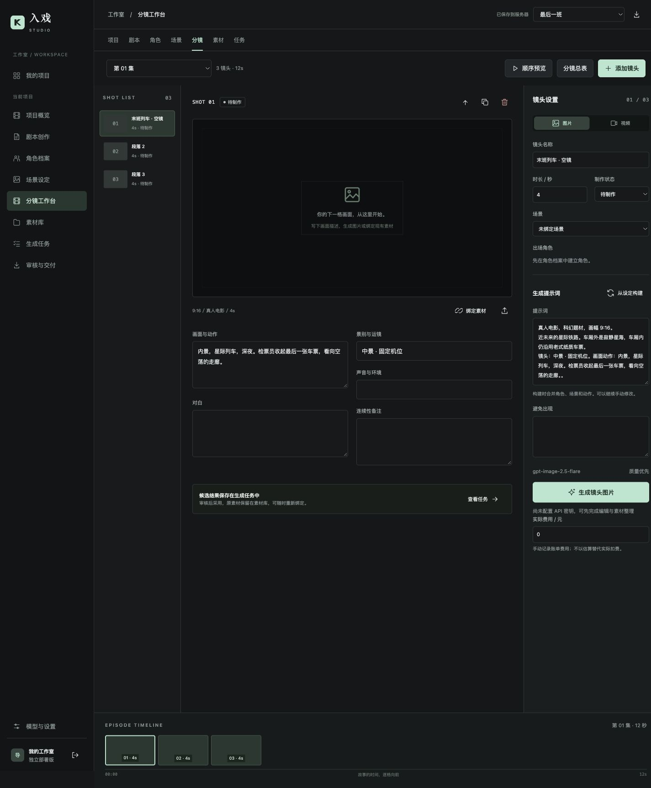

# 入戏 Studio

可自部署的通用 AI 短剧制作工作台。面向个人创作者，从故事、分集剧本、角色/场景到分镜、模型生成、素材审核与交付；支持现代、古装、悬疑、爱情、喜剧、科幻等题材，真人与动画风格均可。

**这是真实后端应用，不依赖 ChatGPT Sites。** Python / Flask / Gunicorn + SQLite + 磁盘素材；前端为无构建依赖的 ES Modules。



## 功能

- 浅色、深色与跟随系统三种主题，右上角切换并记住选择。
- 多项目、多分集；原创题材模板与自由创作。
- 剧本编辑、自动保存、冲突保护、50 条历史版本、未保存草稿恢复。
- 角色与场景档案、参考图、镜头关联；从设定构建生成提示词。
- 创建或编辑角色时可直接上传参考图（JPG/PNG/WebP，最大 20MB），即时预览并保留草稿。
- 创建或编辑角色时直接 AI 生成竖幅定妆图，保留既定外貌服装；候选审核后设为角色参考图。
- 分镜列表、画面预览、镜头属性、顺序预览、镜头复制/排序。
- 文本：Responses / Chat Completions 两种适配器，剧本与结构化分镜。
- 图片：GPT Image 生成和参考图编辑，高质量输出，结果持久保存。
- 视频：OpenAI 视频 API / 火山引擎 Seedance 适配器，首帧参考、异步查询、下载入库。
- 持久化任务队列、请求幂等、重启恢复远端视频任务、不自动重试可能已计费的提交。
- 素材上传（PNG/JPG/WebP/MP4/MP3/WAV）、候选审核后绑定；费用手动记录。
- JSON、制作手册 Markdown、分镜 CSV、分集 SRT、含素材 ZIP 交付包。
- 管理员登录、CSRF、Cookie 会话、登录限流、文件格式检查、密钥只在服务端。

## 5 分钟部署

需要已安装 Docker Engine 与 Docker Compose。默认只监听服务器本机 `127.0.0.1:8080`。

```bash
git clone https://github.com/xiashuying5283/ruxi-studio.git
cd ruxi-studio
python3 deploy/init_env.py
# 用本地编辑器打开 .env：设置 DOMAIN、API 密钥及需要的模型
# 管理员密码已随机生成，保存在 .env 的 ADMIN_PASSWORD 中。
docker compose up -d --build
```

已有 Nginx/HTTPS：参考 [Nginx 示例](deploy/nginx.conf.example) 代理到 `127.0.0.1:8080`。

使用内置 Caddy 自动 HTTPS（域名 DNS 已指向服务器，80/443 空闲）：

```bash
# .env 设置 DOMAIN=你的域名，并保持 COOKIE_SECURE=1
docker compose -f compose.yaml -f compose.https.yaml up -d --build
```

访问 `https://你的域名`，使用 `.env` 中的管理员密码登录。

**无域名临时测试**：设置 `COOKIE_SECURE=0`，使用 SSH 隧道 `ssh -L 8080:127.0.0.1:8080 用户@服务器`，在本机打开 `http://localhost:8080`。正式 HTTPS 部署恢复为 `1`。

## 模型配置

`.env` 中密钥不提交 GitHub，不在浏览器中填写；修改后重建容器：

```bash
docker compose up -d --force-recreate
```

| 用途 | 默认模型 / 接口 | 可更换配置 |
|---|---|---|
| 文本 | `gpt-6-astra` / Responses | `TEXT_MODEL`, `TEXT_BASE_URL`, `TEXT_API_KEY`, `TEXT_ADAPTER=openai` 或 `chat` |
| 图片 | `gpt-image-2.5-flare` / GPT Image | `IMAGE_MODEL`, `IMAGE_QUALITY`, `IMAGE_BASE_URL`, `IMAGE_API_KEY` |
| 视频 | `sora-2-pro` / OpenAI Videos | `VIDEO_MODEL`, `VIDEO_BASE_URL`, `VIDEO_API_KEY`, `VIDEO_ADAPTER` |

同一个 OpenAI 密钥可设置 `OPENAI_API_KEY`，各用途专用密钥优先。模型可用性、费用、地域、额度与账号权限以服务商为准。没有单一模型适合所有题材，默认是可调整的质量优先配置，不代表全球质量排名。

火山引擎视频配置：

```dotenv
VIDEO_ADAPTER=seedance
VIDEO_BASE_URL=https://ark.cn-beijing.volces.com/api/v3
VIDEO_API_KEY=你的方舟密钥
VIDEO_MODEL=你已开通的模型ID
VIDEO_RESOLUTION=1080p
```

视频下载域名不在白名单时，在 `MEDIA_HOST_SUFFIXES` 中增加**明确的服务商 CDN 域名后缀**。不要放开到任意域名。OpenAI 适配器当前采用 4/8/12 秒，16:9/9:16，720p；图片默认 max 档，可用 IMAGE_QUALITY 调整。Seedance 默认请求 1080p，支持范围取决于所选模型。

**真人连续性限制**：OpenAI 当前视频文档对人脸参考图有约束，Seedance 不同型号也有真人输入限制；适配器不绕过服务商限制。先用自己的账号测试目标模型是否允许所需素材。文字描述中的角色参考不能保证跨镜头绝对一致。

API 文档与实现范围见 [模型接入说明](docs/providers.md)。

## 开发与测试

```bash
python3 -m venv .venv
.venv/bin/pip install -r requirements.lock
python3 deploy/init_env.py
# 开发启动需要加载 .env；下列仅用于本机预览的显式变量示例：
SECRET_KEY=local-preview-only-key-not-for-production-2026 \
ADMIN_PASSWORD=local-preview-only-2026 COOKIE_SECURE=0 DATA_DIR=./data \
.venv/bin/python -m server.dev
```

另开终端启动 worker，使用相同环境变量（尤其 `DATA_DIR`、模型配置）：

```bash
DATA_DIR=./data .venv/bin/python -m server.worker
.venv/bin/python -m unittest discover -s tests -v
```

正式运行由 Compose 载入 `.env`。`python -m server.dev` 不自动加载 dotenv 文件，开发时请用 IDE 环境变量配置或明确导出需要的变量。

## 备份、升级与恢复

见 [运维说明](docs/operations.md)。只更新镜像不会清除 `studio_data` 卷；**不要使用 `docker compose down -v`**。项目 JSON 仅恢复文字档案，ZIP 用于交付，完整恢复需备份数据库和素材目录。

## 当前边界

- 单管理员私有工作室，无多人权限、实时协作或商业计费系统。
- 非完整剪辑器；顺序预览按镜头时长播放。精剪、口型配音、转场、混音和最终 MP4 导出交由剪辑软件。
- 生成按单个任务提交，不自动大批量消耗模型额度；费用从服务商账单手动录入。
- 无默认演示数据、假生成成功或前端假进度。未配置密钥仍可完整编辑与管理项目。
- SQLite/本地磁盘适合单机工作室。ZIP 打包使用磁盘临时文件，需要足够的可用磁盘；不提供多节点部署。
